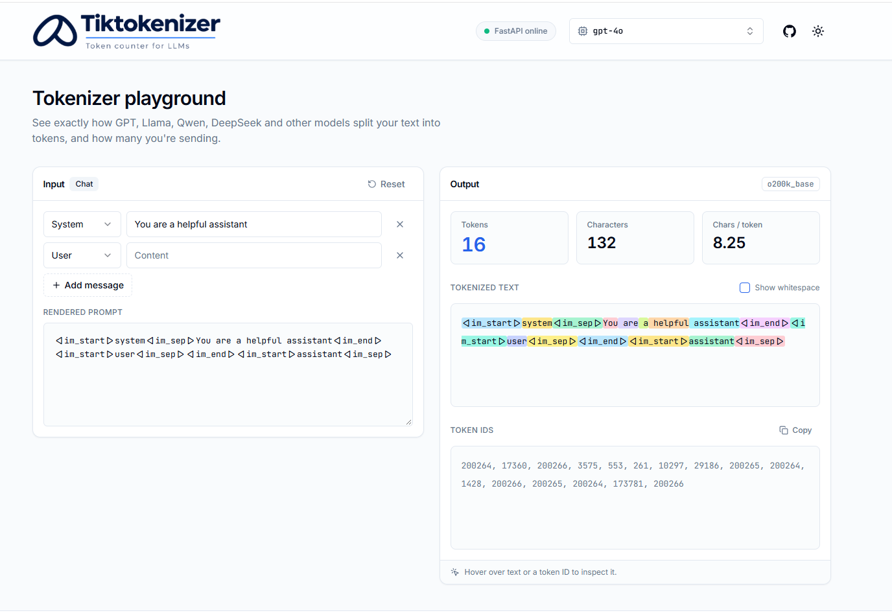
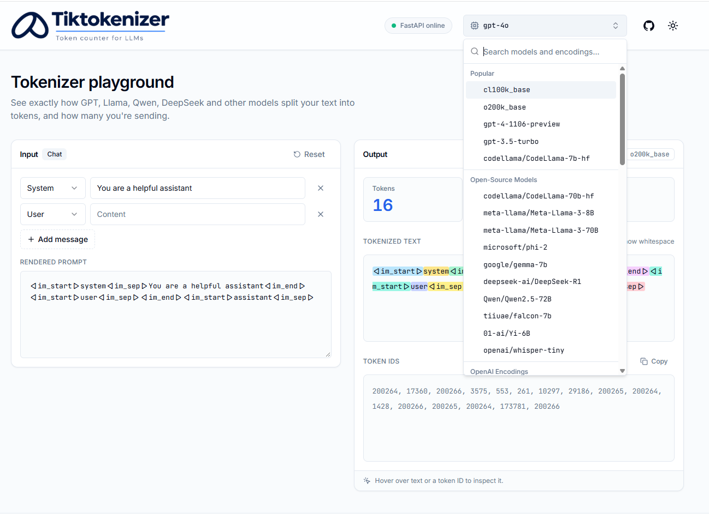
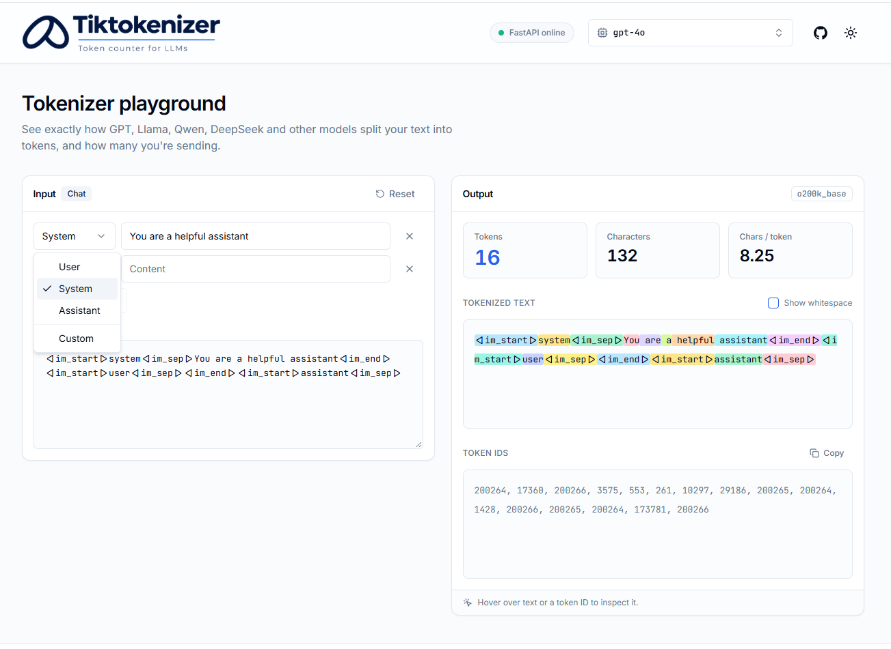

# Tiktokenizer

<p align="center">
  <picture>
    <source media="(prefers-color-scheme: dark)" srcset="./tokenizer-client/public/Lockup%20on%20navy%401x.png">
    <source media="(prefers-color-scheme: light)" srcset="./tokenizer-client/public/Primary%20lockup%401x.png">
    
  </picture>
</p>

## Overview

This repository is a token counter and visualizer for LLMs. It shows exactly how GPT, Llama, Qwen, DeepSeek and other models split your text into tokens, and how many tokens you are sending.

It is made of two parts: a FastAPI backend that does the tokenizing, and a React client that highlights every token alongside its ID.

## How It Works

Let us have a bird's eye view of what happens when you type text into the playground.

Example: *Every moment is a beginning*

<p align="center">
  
</p>

The client sends the text and the selected model to the backend. The backend tokenizes the text and returns the token IDs plus *segments*: runs of tokens aligned to whole characters of the input. This way emoji and CJK text that are split across several tokens still highlight correctly.

## Contents

- [Features](#features)
- [Supported Models](#supported-models)
- [Tokenization](#tokenization)
- [Chat Mode](#chat-mode)
- [Architecture](#architecture)
- [Install Dependencies](#install-dependencies)
- [Configuration](#configuration)
- [API](#api)
- [Development](#development)
- [Contributing](#contributing)
- [Acknowledgments](#acknowledgments)

## Features

| Feature | Description |
|---|---|
| Accurate token counts | OpenAI models and encodings via [tiktoken](https://github.com/openai/tiktoken), open-source models via Hugging Face [tokenizers](https://github.com/huggingface/tokenizers) |
| Token visualization | Every piece of text is highlighted alongside its token IDs. Hover either side to see the segment's text, token count and IDs |
| Chat mode | Build a conversation from system, user, assistant and custom-named messages. The count includes the ChatML markup the model actually receives |
| Stats at a glance | Tokens, characters and characters per token |
| Shareable links | The selected model is kept in the URL (`?model=gpt-4o`) |
| Themes | Light and dark themes, responsive down to phone widths |

## Supported Models

| Group | Models |
|---|---|
| OpenAI encodings | `gpt2`, `r50k_base`, `p50k_base`, `p50k_edit`, `cl100k_base`, `o200k_base` |
| OpenAI chat models | `gpt-4o`, `gpt-4`, `gpt-4-32k`, `gpt-4-1106-preview`, `gpt-3.5-turbo` |
| OpenAI embedding and legacy models | `text-embedding-3-small/large`, `text-embedding-ada-002`, `davinci`, `curie`, … |
| Open-source models | CodeLlama 7B/70B, Llama 3 8B/70B\*, Gemma 7B\*, Phi-2, DeepSeek-R1, Qwen2.5-72B, Falcon-7B, Yi-6B, Whisper tiny |

\* Gated on Hugging Face. They need an `HF_API_KEY` from an account that has been granted access (see [Configuration](#configuration)).

Pick any of them from the searchable model picker:

<p align="center">
  
</p>

## Tokenization

Tokenization is the process of splitting a text into smaller units called tokens. These tokens are the fundamental building blocks an LLM works with.

Input Sentence: "Every moment is a beginning"

Tokens: ["Every", " moment", " is", " a", " beginning"]

After tokenization, each token is mapped to a numerical ID from the model's vocabulary. Different models use different vocabularies, so the same sentence can produce a different number of tokens depending on the model you pick.

Tiktokenizer shows you both sides:

- **Left**: your text, with each token highlighted in its own color.
- **Right**: the matching token IDs.

Hover a segment on either side to see its text, token count and IDs. Some tokenizers also insert tokens on their own, such as a `<s>` beginning-of-sequence token. These are marked as *special*.

## Chat Mode

Chat models don't receive your messages as plain text. Each message is wrapped in markup (ChatML) that tells the model who is speaking:

```text
<|im_start|>system
You are a helpful assistant<|im_end|>
<|im_start|>user
Every moment is a beginning<|im_end|>
<|im_start|>assistant
```

This is the `gpt-3.5-turbo` layout. Other chat models separate the role from the content with `<|im_sep|>` instead of a newline.

Chat mode lets you build a conversation from system, user, assistant and custom-named messages. The token count includes this markup, so it matches what the model actually receives.

<p align="center">
  
</p>

## Architecture

```text
tiktokenizer/
├── tokenizer/          # FastAPI backend (Python)
│   ├── main.py         # App entry point, CORS
│   ├── app/            # Catalog, tokenizers, segmenting, HF downloads, API routes
│   ├── download.py     # Pre-fetch open-source tokenizer files
│   └── tests/
└── tokenizer-client/   # React + TypeScript frontend (Vite, Tailwind, TanStack Query)
    └── src/
        ├── pages/      # Home page
        ├── sections/   # Header, input panel, output panel, model picker, chat editor
        ├── components/ # UI primitives, logo, social links
        └── lib/        # API client, chat formatting, site config
```

### Overall Flow

```text
Text + Model
     ↓
React Client
     ↓
POST /api/v1/tokenize
     ↓
tiktoken / HF tokenizers
     ↓
Token IDs + Segments
     ↓
Highlighted Output
```

## Install Dependencies

Prerequisites: Python 3.11+ and Node.js 18+.

**1. Backend**

```sh
cd tokenizer
python -m venv .venv
.venv\Scripts\activate            # macOS/Linux: source .venv/bin/activate
pip install -r requirements.txt
cp .env.example .env              # then fill in HF_API_KEY (optional)
python download.py                # optional: pre-fetch open-source tokenizers
fastapi dev main.py               # http://127.0.0.1:8000 (interactive docs at /docs)
```

**2. Frontend**

```sh
cd tokenizer-client
npm install
cp .env.example .env              # points the client at the backend
npm run dev                       # http://localhost:5173
```

## Configuration

**`tokenizer/.env`**

| Variable | Default | Description |
|---|---|---|
| `HF_API_KEY` | *(empty)* | Hugging Face token. Required only for gated models (Llama 3, Gemma). Fine-grained tokens need *"Read access to contents of all public gated repos you can access"* enabled. |
| `CORS_ORIGINS` | `http://localhost:5173,http://127.0.0.1:5173` | Comma-separated origins allowed to call the API. |
| `HF_CACHE_DIR` | `./hf_cache` | Where downloaded tokenizer files are stored. |

**`tokenizer-client/.env`**

| Variable | Default | Description |
|---|---|---|
| `VITE_API_URL` | *(empty)* | Backend base URL, e.g. `http://127.0.0.1:8000`. If empty, the client calls `/api` on its own origin. |
| `API_PROXY_TARGET` | `http://127.0.0.1:8000` | Dev only: where the Vite dev server proxies `/api` when `VITE_API_URL` is empty. |

## API

| Method | Endpoint | Description |
|---|---|---|
| `GET` | `/api/v1/models` | Supported models and encodings, grouped for display |
| `POST` | `/api/v1/tokenize` | Token IDs, count and highlighted segments for `{ model, text }` |
| `GET` / `POST` | `/api/v1/encode` | Simple count: `text` plus `encoder` or `model` → `{ name, tokens, count }` |
| `GET` | `/health` | Liveness check |

Example:

```sh
curl -X POST http://127.0.0.1:8000/api/v1/tokenize \
  -H "Content-Type: application/json" \
  -d '{"model": "gpt-4o", "text": "Hello world"}'
```

```json
{
  "name": "o200k_base",
  "model": "gpt-4o",
  "count": 2,
  "tokens": [13225, 2375],
  "segments": [
    { "text": "Hello", "tokens": [{ "id": 13225, "idx": 0 }], "special": false },
    { "text": " world", "tokens": [{ "id": 2375, "idx": 1 }], "special": false }
  ]
}
```

`special: true` marks tokens the tokenizer inserts on its own, such as a `<s>` beginning-of-sequence token.

## Development

```sh
# Backend tests
cd tokenizer && pytest

# Frontend typecheck, lint and production build
cd tokenizer-client
npm run typecheck
npm run lint
npm run build
```

## Contributing

We welcome contributions! If you have improvements, new models, or fixes to suggest:

1. Fork the repository.
2. Create a feature branch: `git checkout -b feature/YourFeature`.
3. Make your changes and run the tests and lint checks above.
4. Commit your changes: `git commit -m 'Add YourFeature'`.
5. Push your branch: `git push origin feature/YourFeature`.
6. Open a pull request for review.

## Acknowledgments

Based on [Tiktokenizer](https://github.com/dqbd/tiktokenizer) by [dqbd](https://github.com/dqbd), originally built with Next.js. This version re-implements it as a FastAPI service and a standalone React client.

## Author

**Brian Kerio**: [GitHub](https://github.com/BKerio) · [X](https://x.com/_briankerio) · [LinkedIn](https://www.linkedin.com/in/briankerio/)

---

<p align="center">
  
</p>

⭐️ If you find this repository helpful, please consider giving it a star!

Keywords: AI, LLMs, Tokenization, Tokenizer, tiktoken, Hugging Face, GPT, Llama, FastAPI, React
