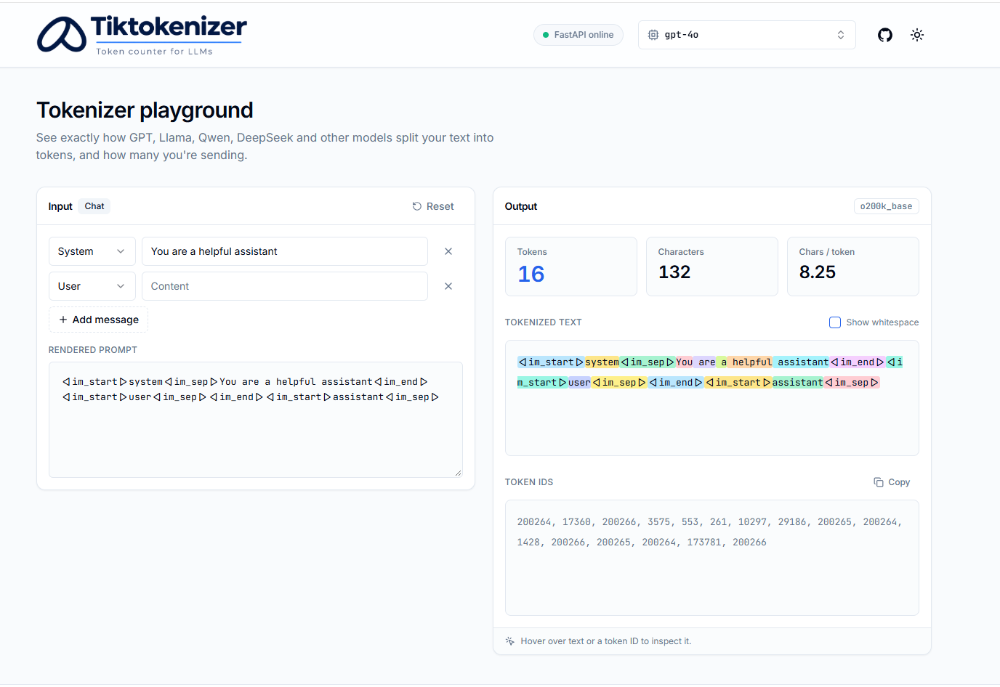
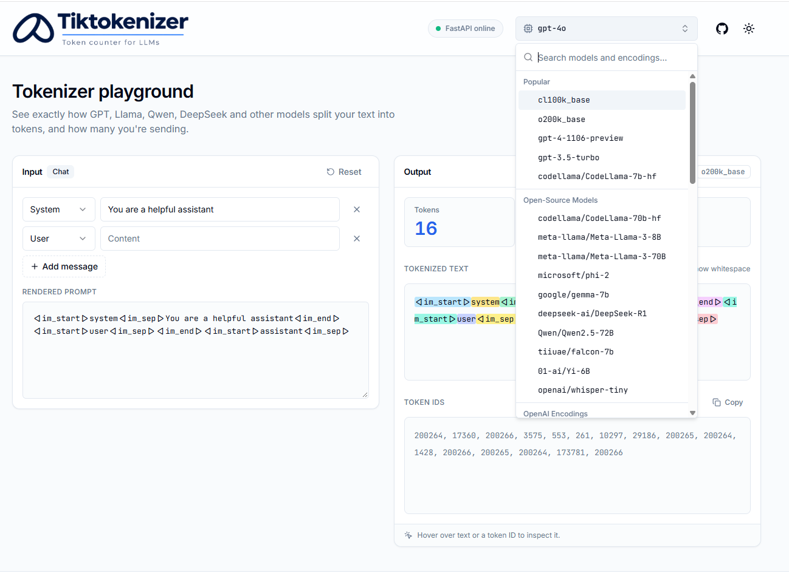
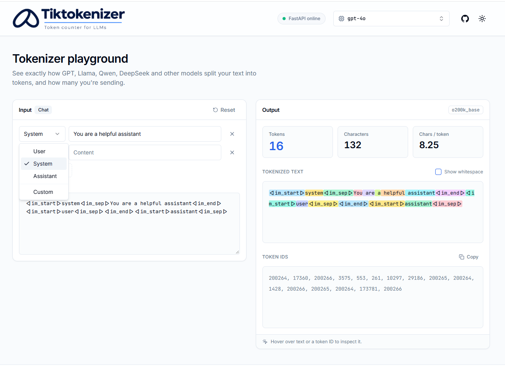

<p align="center">
  
</p>

<p align="center">
  See exactly how GPT, Llama, Qwen, DeepSeek and other models split your text into tokens, and how many you're sending.
</p>

---



## Features

- **Accurate token counts** for OpenAI models and encodings (via [tiktoken](https://github.com/openai/tiktoken)) and popular open-source models (via Hugging Face [tokenizers](https://github.com/huggingface/tokenizers)).
- **Token visualization**: every piece of text is highlighted alongside its token IDs. Hover either side to see the segment's text, token count and IDs.
- **Chat mode** for chat models: build a conversation from system, user, assistant and custom-named messages. The count includes the ChatML markup the model actually receives.
- **Stats at a glance**: tokens, characters and characters per token.
- **Shareable links**: the selected model is kept in the URL (`?model=gpt-4o`).
- **Light and dark themes**, responsive down to phone widths.

| Model picker | Chat editor |
| --- | --- |
|  |  |

## Supported models

| Group | Models |
| --- | --- |
| OpenAI encodings | `gpt2`, `r50k_base`, `p50k_base`, `p50k_edit`, `cl100k_base`, `o200k_base` |
| OpenAI chat models | `gpt-4o`, `gpt-4`, `gpt-4-32k`, `gpt-4-1106-preview`, `gpt-3.5-turbo` |
| OpenAI embedding and legacy models | `text-embedding-3-small/large`, `text-embedding-ada-002`, `davinci`, `curie`, … |
| Open-source models | CodeLlama 7B/70B, Llama 3 8B/70B\*, Gemma 7B\*, Phi-2, DeepSeek-R1, Qwen2.5-72B, Falcon-7B, Yi-6B, Whisper tiny |

\* Gated on Hugging Face. They need an `HF_API_KEY` from an account that has been granted access (see [Configuration](#configuration)).

## Architecture

```
tiktokenizer/
├── tokenizer/          # FastAPI backend (Python)
│   ├── main.py         # App entry point, CORS
│   ├── app/            # Catalog, tokenizers, segmenting, HF downloads, API routes
│   ├── download.py     # Pre-fetch open-source tokenizer files
│   └── tests/
└── tokenizer-client/   # React + TypeScript frontend (Vite, Tailwind, TanStack Query)
    └── src/
        ├── pages/      # Home page
        ├── sections/   # Header, input panel, output panel, model picker, chat editor
        ├── components/ # UI primitives, logo, social links
        └── lib/        # API client, chat formatting, site config
```

The client sends the text and the selected model to the backend. The backend tokenizes the text and returns the token IDs plus *segments*: runs of tokens aligned to whole characters of the input, so emoji and CJK text split across several tokens still highlight correctly.

## Getting started

### Prerequisites

- Python 3.11+
- Node.js 18+

### 1. Backend

```sh
cd tokenizer
python -m venv .venv
.venv\Scripts\activate            # macOS/Linux: source .venv/bin/activate
pip install -r requirements.txt
cp .env.example .env              # then fill in HF_API_KEY (optional)
python download.py                # optional: pre-fetch open-source tokenizers
fastapi dev main.py               # http://127.0.0.1:8000 (interactive docs at /docs)
```

### 2. Frontend

```sh
cd tokenizer-client
npm install
cp .env.example .env              # points the client at the backend
npm run dev                       # http://localhost:5173
```

## Configuration

**`tokenizer/.env`**

| Variable | Default | Description |
| --- | --- | --- |
| `HF_API_KEY` | *(empty)* | Hugging Face token. Required only for gated models (Llama 3, Gemma). Fine-grained tokens need *"Read access to contents of all public gated repos you can access"* enabled. |
| `CORS_ORIGINS` | `http://localhost:5173,http://127.0.0.1:5173` | Comma-separated origins allowed to call the API. |
| `HF_CACHE_DIR` | `./hf_cache` | Where downloaded tokenizer files are stored. |

**`tokenizer-client/.env`**

| Variable | Default | Description |
| --- | --- | --- |
| `VITE_API_URL` | *(empty)* | Backend base URL, e.g. `http://127.0.0.1:8000`. If empty, the client calls `/api` on its own origin. |
| `API_PROXY_TARGET` | `http://127.0.0.1:8000` | Dev only: where the Vite dev server proxies `/api` when `VITE_API_URL` is empty. |

## API

| Method | Endpoint | Description |
| --- | --- | --- |
| `GET` | `/api/v1/models` | Supported models and encodings, grouped for display |
| `POST` | `/api/v1/tokenize` | Token IDs, count and highlighted segments for `{ model, text }` |
| `GET` / `POST` | `/api/v1/encode` | Simple count: `text` plus `encoder` or `model` → `{ name, tokens, count }` |
| `GET` | `/health` | Liveness check |

Example:

```sh
curl -X POST http://127.0.0.1:8000/api/v1/tokenize \
  -H "Content-Type: application/json" \
  -d '{"model": "gpt-4o", "text": "Hello world"}'
```

```json
{
  "name": "o200k_base",
  "model": "gpt-4o",
  "count": 2,
  "tokens": [13225, 2375],
  "segments": [
    { "text": "Hello", "tokens": [{ "id": 13225, "idx": 0 }], "special": false },
    { "text": " world", "tokens": [{ "id": 2375, "idx": 1 }], "special": false }
  ]
}
```

`special: true` marks tokens the tokenizer inserts on its own, such as a `<s>` beginning-of-sequence token.

## Development

```sh
# Backend tests
cd tokenizer && pytest

# Frontend typecheck, lint and production build
cd tokenizer-client
npm run typecheck
npm run lint
npm run build
```

## Acknowledgments

Based on [Tiktokenizer](https://github.com/dqbd/tiktokenizer) by [dqbd](https://github.com/dqbd), originally built with Next.js. This version re-implements it as a FastAPI service and a standalone React client.

## Author

**Brian Kerio**: [GitHub](https://github.com/BKerio) · [X](https://x.com/_briankerio) · [LinkedIn](https://www.linkedin.com/in/briankerio/)
